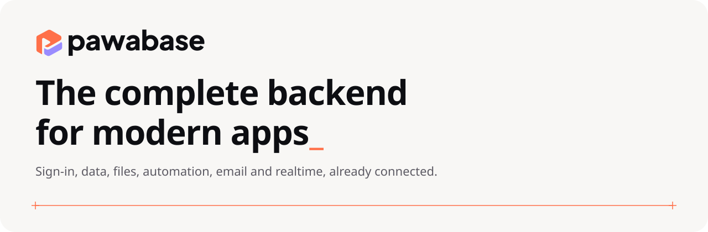

<p align="center">
  <picture>
    <source media="(prefers-color-scheme: dark)" srcset="docs/assets/banner-dark.svg">
    
  </picture>
</p>

<h3 align="center">The open backend for apps that need to stay yours.</h3>

<p align="center">
  Sign-in, a database with an API, files, realtime and functions, in one platform you run on your own infrastructure.
  <br>
  Everything Supabase and Firebase give you out of the box, without handing over your data or your bill.
</p>

<p align="center">
  <a href="https://github.com/Pawabase/pawabase-docs"><b>Docs</b></a> ·
  <a href="#get-started-in-two-minutes"><b>Get started</b></a> ·
  <a href="https://github.com/Pawabase/pawabase-python"><b>Python</b></a> ·
  <a href="https://github.com/Pawabase/pawabase-js"><b>TypeScript</b></a> ·
  <a href="#pawabase-cloud"><b>Cloud</b></a>
</p>

---

## Ship the product, not the plumbing

Every app ends up needing the same things: people signing in, data with rules, files, live updates, and work that
happens in the background. Pawabase is all of it, already connected, with one place to run it.

|  |  |
| --- | --- |
| **A database with an API** <br> Describe a table and get a secure REST API, with filtering, sorting, relations and generated docs. Your data stays in plain Postgres, MySQL or SQLite. | **Sign-in that scales to teams** <br> Email, social sign-in, two-step verification, organizations, roles and invitations, built in and usable in your rules. |
| **Rules you can read** <br> Say who can list, read, create, update and delete in plain conditions. They hold on every request and every file. | **Files with the same rules** <br> Buckets, uploads and expiring links on local disk or any S3-compatible storage. |
| **Realtime** <br> Channels with broadcast, presence and history, over WebSockets, guarded by the same rules. | **Functions and workflows** <br> Write Python, or build the flow visually. Run it on a schedule, on an event, or from a webhook, with retries. |
| **Studio** <br> One dashboard for all of it: data, users, logs, queues, keys, topology of how your data connects. | **Real environments** <br> Development, staging and production side by side, each with its own keys, with releases and branches for safe changes. |

## Why teams choose Pawabase

- **It is yours.** Run it anywhere you run containers. Your database, your storage, your network, your region. No
  vendor in the middle and nothing to export when you grow.
- **No meter on your users.** You pay for your own infrastructure, not per read, per write or per sign-in.
- **Familiar underneath.** Real SQL databases, S3-compatible storage, plain HTTP and WebSockets. Move off whenever
  you like.
- **One platform, not twelve services.** Sign-in, data, files, realtime and automation share one set of rules and one
  place to look when something is wrong.
- **Operations included.** Metrics and alarms that email you, a public status page, backups and snapshots, key and
  secret rotation, custom domains and a firewall.

## How it compares

| | Pawabase | Supabase | Firebase |
| --- | :---: | :---: | :---: |
| Self-host the whole platform | ✅ | ✅ | ❌ |
| Bring your own database | ✅ Postgres, MySQL, SQLite | Postgres | ❌ |
| Open source | ✅ BSD-3 | ✅ | ❌ |
| Access rules you can read | ✅ | ✅ | ✅ |
| Server logic in | Python | TypeScript | JavaScript, Python |
| Visual workflow builder | ✅ | ❌ | ❌ |
| Realtime and presence | ✅ | ✅ | ✅ |
| Teams, roles and invitations built in | ✅ | ➖ build it | ➖ build it |

<sub>Based on each product's public documentation. Check theirs for the details that matter to you.</sub>

## Get started in two minutes

You need Docker.

```sh
git clone https://github.com/Pawabase/pawabase && cd pawabase
cp .env.test .env
docker compose up -d
```

Open **Studio** at <http://localhost:8090> and your API is at <http://localhost:8080>. Then:

```sh
# Read a table
curl http://localhost:8080/rest/v1/todos -H "apikey: <publishable key>"

# Sign someone up
curl -X POST http://localhost:8080/auth/v1/signup \
  -H "apikey: <publishable key>" -H "content-type: application/json" \
  -d '{"email":"ada@example.com","password":"Str0ng!pass"}'
```

Or from your app:

```ts
import { createClient } from "@pawabase/client";

const pawabase = createClient({ url: "http://localhost:8080", apiKey: "<publishable key>" });
const todos = await pawabase.from("todos").eq("done", false).perPage(20);
```

Using Python? `pip install pawabase`.

## Run it for real

```sh
cp .env.example .env     # set the secrets: `openssl rand -hex 32` for each one
docker compose up -d
```

Point Pawabase at your own Postgres, Redis and S3-compatible storage with the variables in `.env.example`. In
production mode it refuses to start while a development secret is still in place. Put TLS in front of it, turn on
Studio's sign-in, and you are live. When you outgrow one server, add more and share a Redis.

## Pawabase Cloud

Would you rather we run it? Pawabase Cloud gives you a project with its own database in a minute, and bills by
subscription. It is in pre-launch.

## Learn more

| | |
| --- | --- |
| [Documentation](https://github.com/Pawabase/pawabase-docs) | Guides and reference |
| [Python library and CLI](https://github.com/Pawabase/pawabase-python) | `pip install pawabase` |
| [TypeScript client](https://github.com/Pawabase/pawabase-js) | `@pawabase/client` |
| [Upgrading](docs/upgrading.md) | Moving an older installation forward |
| [Architecture](ARCHITECTURE.md) | How it is built, for contributors |

Contributing? `docker compose -f docker-compose.dev.yml up` starts everything with live reload.

## License

BSD-3-Clause
